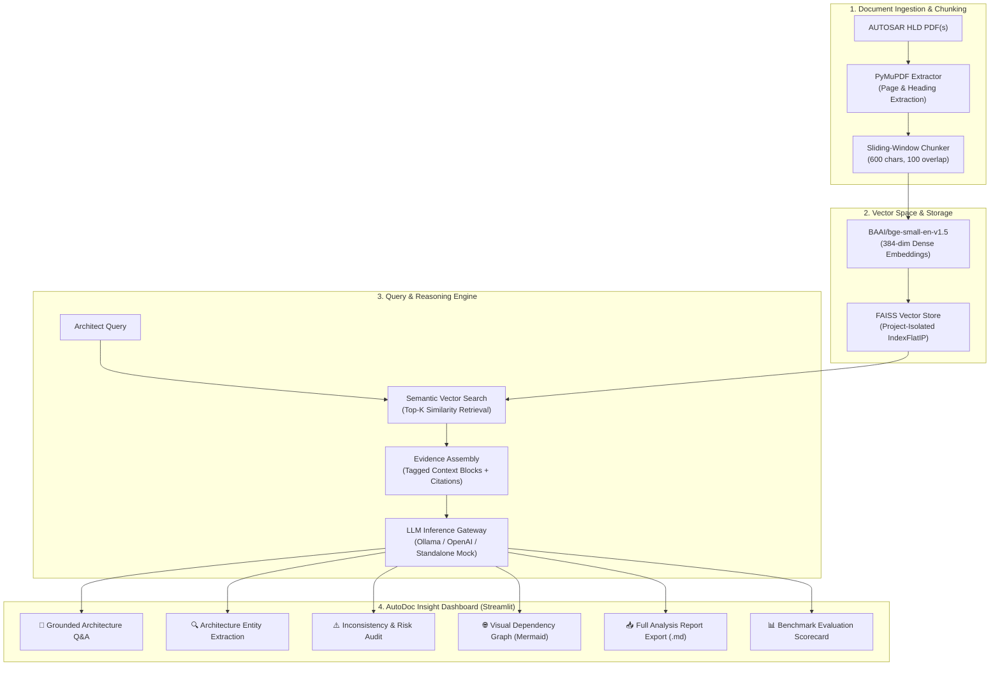

# ⚡ AutoDoc Insight — AUTOSAR Architecture Intelligence Platform

**Tata Technologies TechPulse FY-26 — Applied AI/ML Capstone**  
**Case Study CS1: Automated AUTOSAR High-Level Design (HLD) Document Analysis & Verification Assistant**

[](https://www.python.org/)
[](https://streamlit.io/)
[](https://github.com/facebookresearch/faiss)
[](https://huggingface.co/BAAI/bge-small-en-v1.5)
[](tests/)
[](#17-responsible-ai--data-privacy)

> **AutoDoc Insight** is an enterprise-grade Retrieval-Augmented Generation (RAG) platform purpose-built for automotive software architects and systems engineers. It ingests complex AUTOSAR High-Level Design (HLD) PDF specifications, extracts structured software entities, exposes architectural dependencies via visual diagrams, flags specification inconsistencies, and answers technical design queries backed by **strictly verifiable page citations**.

---

## 1. Problem Statement & Motivation

In contemporary Software-Defined Vehicles (SDVs), automotive engineering teams manage hundreds of pages of AUTOSAR High-Level Design (HLD) documents covering Body, Chassis, Powertrain, ADAS, and Infotainment domains.

**Key Challenges Faced by Automotive Engineers:**
1. **Information Scavenging:** Engineers spend hours searching cross-component interactions, port interfaces, and signal allocations across 50–200+ page PDF specifications.
2. **Hidden Inconsistencies:** Subtle mismatches between sender-receiver interfaces, conflicting port directions, or unreferenced dependencies often go unnoticed until ECU integration, causing costly re-spins.
3. **Traceability & Hallucination Risks:** Generic generative AI systems frequently hallucinate nonexistent AUTOSAR APIs, layers, or signal paths.
4. **Data Privacy & IP Protection:** Proprietary automotive architecture specifications must not be leaked to public cloud LLMs without governance.

**The AutoDoc Insight Solution:**  
AutoDoc Insight provides an **air-gapped, privacy-first, citation-grounded RAG intelligence pipeline** that extracts, verifies, and reasons over AUTOSAR design documentation with strict mathematical grounding and page-level audit trails.

---

## 2. Core Capabilities & Value Proposition

| Capability | Technical Realization | Engineering Benefit |
|---|---|---|
| **Page-Aware PDF Ingestion** | PyMuPDF with font-heuristic heading detection | Preserves exact page numbers, chapter hierarchy, and table structures |
| **Project-Isolated Vector Store** | Dense FAISS `IndexFlatIP` with SHA-256 project hash | Zero data bleed between different vehicle programs or ECU designs |
| **Local Semantic Embeddings** | `BAAI/bge-small-en-v1.5` (384-dimensional dense vectors) | High domain semantic matching without cloud latency or subscription fees |
| **Grounded Answering** | Strict prompt engineering + similarity thresholding | Answers are constrained to retrieved evidence; outputs "Insufficient evidence" when ungrounded |
| **Full Analysis Report Export** | Consolidated Markdown export engine | Generates audit-ready reports covering architecture, inconsistencies, diagrams, and metrics |
| **Visual Architecture Mapping** | Dynamic Mermaid graph generation | Visualizes SWC dependencies and communication flows automatically |
| **Inconsistency Detection** | LLM cross-verification across sections | Flags interface mismatches, dangling ports, and terminology contradictions |
| **Evaluation Benchmark** | Automated evaluation runner (15 domain Q&As) | Provides quantifiable metrics: Retrieval Success, Citation Coverage, Groundedness |

---

## 3. System Architecture



---

## 4. End-to-End RAG Workflow

```
AUTOSAR HLD Document (Uploaded PDF / Demo HLD)
       │
       ▼ PyMuPDF Ingestion
Page-level text blocks with detected section headings
       │
       ▼ Sliding-Window Chunking (600 chars, 100 overlap)
Chunks with metadata: {chunk_id, doc_name, page, heading, text, char_count}
       │
       ▼ Sentence Transformers (BAAI/bge-small-en-v1.5)
384-dimensional normalized dense embedding vectors
       │
       ▼ FAISS IndexFlatIP (Cosine Similarity)
Project-isolated index persisted in vector_store/<project_id>/
       │
       ▼ Engineer Query ("What interfaces does the CANDriver expose?")
Top-K nearest chunks retrieved with similarity scores (0.0 to 1.0)
       │
       ▼ Context Assembly & Citation Injection
[1] Source: AUTOSAR_HLD.pdf | Page 5 | Section: 4.2 CAN Interface
       │
       ▼ LLM Reasoning (Local Ollama Llama 3.1 / OpenAI GPT-4o-mini / Standalone Mock)
Formulates grounded technical response strictly matching retrieved evidence
       │
       ▼ Delivery in UI & Report Exporter
Answer + Confidence Rating + Page Citations + Raw Passage Expanders
```

---

## 5. Technology Stack

| Layer | Technology | Justification |
|---|---|---|
| **UI & Dashboard** | Streamlit 1.30+ | High-interactivity, reactive engineering dashboard with cyber-dark theme |
| **PDF Extraction** | PyMuPDF (`fitz`) | 10x faster than PyPDF2; captures exact page indices, fonts, and headings |
| **Vector Index** | FAISS (`faiss-cpu`) | High-performance Facebook AI Similarity Search; local and project-isolated |
| **Embeddings** | `sentence-transformers` | BAAI/bge-small-en-v1.5 offers state-of-the-art MTEB retrieval performance |
| **Local LLM** | Ollama (`llama3.1`) | Free, private, air-gapped local execution without external API dependencies |
| **Cloud LLM (Optional)** | OpenAI API (`gpt-4o-mini`) | High-speed, high-accuracy inference for commercial cloud workflows |
| **Report Generation** | Custom Markdown / Mermaid Engine | Generates publication-grade compliance documentation with one click |
| **Automated Testing** | `pytest` & `unittest` | 32 comprehensive tests validating ingestion, vector store, RAG, and reporting |

---

## 6. Project Structure

```
AUTOSAR-HLD-AI-Assistant/
├── app/
│   ├── main.py                    # AutoDoc Insight Streamlit Dashboard
│   ├── ingestion/
│   │   ├── pdf_extractor.py       # Page-aware text & heading extraction
│   │   └── chunker.py             # Sliding-window semantic chunker
│   ├── rag/
│   │   ├── pipeline.py            # RAG orchestration & citation binding
│   │   ├── vector_store.py        # FAISS vector store manager
│   │   └── llm_client.py          # Multi-backend LLM client (Ollama/OpenAI/Mock)
│   ├── extraction/
│   │   └── arch_extractor.py      # Structured component, interface, and signal extractor
│   ├── reporting/
│   │   ├── __init__.py            # Reporting module exports
│   │   └── report_generator.py    # Full Analysis Report & Mermaid diagram generator
│   ├── evaluation/
│   │   └── evaluator.py           # Automated evaluation runner & synthetic QA set
│   └── utils/
│       ├── helpers.py             # File hashing, evidence formatting, text cleaning
│       └── synthetic_hld.py       # Synthetic EV Powertrain Control Unit HLD generator
│
├── config/
│   └── settings.py                # Centralized settings & environment parameters
│
├── data/
│   └── input/                     # Uploaded and generated PDF storage
│
├── docs/
│   └── PROJECT_IMPLEMENTATION.md  # Deep technical architecture documentation
│
├── tests/
│   └── test_pipeline.py           # 32 end-to-end integration and unit tests
│
├── run_evaluation.py              # Standalone CLI evaluation runner
├── setup_and_test.py              # Smoke test & system health check (7/7 checks)
├── requirements.txt               # Pinned project dependencies
├── .env.example                   # Environment configuration template
└── README.md                      # Comprehensive project guide & documentation
```

---

## 7. Installation & Quickstart

### Prerequisites
- Python 3.10 or higher
- Git & pip
- *(Optional for real local AI)* [Ollama](https://ollama.ai) installed

### Step 1: Clone Repository
```bash
git clone <your-github-repo-url>
cd AUTOSAR-HLD-AI-Assistant
```

### Step 2: Set Up Virtual Environment
```bash
# Windows
python -m venv venv
venv\Scripts\activate

# Linux / macOS
python3 -m venv venv
source venv/bin/activate
```

### Step 3: Install Dependencies
```bash
pip install -r requirements.txt
```

### Step 4: Verify Environment Health
```bash
python setup_and_test.py
```
*Expected Output: `RESULTS: 7/7 checks passed`*

### Step 5: Launch the AutoDoc Insight Dashboard
```bash
streamlit run app/main.py
```
Open your browser at: **`http://localhost:8501`**

---

## 8. LLM Backend Configuration

AutoDoc Insight operates out of the box in **Standalone Mock Mode** (ideal for rapid offline evaluation without API keys). For real generative answers, select your preferred backend in `.env`:

### Option A: Local Ollama (Recommended — Free, Air-Gapped, Private)
1. Download Ollama from [ollama.ai](https://ollama.ai)
2. Pull the Llama 3.1 model:
   ```bash
   ollama pull llama3.1
   ollama serve
   ```
3. Set in `.env`:
   ```env
   LLM_PROVIDER=ollama
   LLM_MODEL=llama3.1
   OLLAMA_BASE_URL=http://localhost:11434
   ```

### Option B: Cloud OpenAI (High Performance)
1. Set in `.env`:
   ```env
   LLM_PROVIDER=openai
   LLM_MODEL=gpt-4o-mini
   OPENAI_API_KEY=sk-your-openai-api-key
   ```

### Option C: Standalone Mock Mode (Zero Setup Required)
```env
LLM_PROVIDER=mock
```
*Demonstrates the full vector retrieval pipeline, page citations, similarity scores, and report generation without requiring any external model downloads.*

---

## 9. Comprehensive Feature Highlights

### 1. Natural Language Architecture Q&A
- **Grounded Verification:** Every statement is tethered to verifiable page citations (e.g. `AUTOSAR_HLD_Demo.pdf — Page 4, Section: 4. Software Components`).
- **Confidence Scoring:** Automatically computed based on vector similarity distance (`High`, `Medium`, `Low`).
- **Guided Prompt Library:** Instant buttons covering components, interfaces, signals, dependencies, and lifecycle flows.
- **Transcript Export:** Download the entire engineering chat session in Markdown.

### 2. Automated Architecture Extraction & Mermaid Dependency Graph
- Extracts structured entity lists:
  - **🧩 Software Components (SWCs & BSW Modules)**
  - **🔌 Client-Server & Sender-Receiver Interfaces**
  - **🚪 Ports & Directions**
  - **📡 Signals & Payload Definitions**
  - **🔗 Interdependencies & Functional Sequences**
- **Dynamic Mermaid Visualizer:** Generates interactive system interaction flowcharts right inside the browser.
- **Search & Filter:** Instant keyword filtering across all extracted architecture items.

### 3. Inconsistency & Anomaly Audit
- Evaluates document coherence to detect:
  - Conflicting interface definitions across different sections
  - Dangling ports referenced without corresponding receiver components
  - Inconsistent terminology for shared signals or BSW modules
- Categorizes findings by severity: `CRITICAL`, `HIGH`, `MEDIUM`, `LOW` with document citations and verification checklists.

### 4. Full Analysis Report Exporter (New Feature)
- One-click generation of an **Audit-Ready Engineering Markdown Report** combining:
  1. Executive Summary & Document Metadata
  2. High-Level Architecture Narrative
  3. Extracted Software Components, Interfaces, Ports, and Signals
  4. Architectural Dependency Graph (Mermaid)
  5. Inconsistency & Discrepancy Findings
  6. Source Citation Register
  7. System Verification Metrics
  8. Engineering Q&A Transcript
  9. ISO 26262 & AUTOSAR Compliance Disclaimer

---

## 10. Automated Testing & Verification

AutoDoc Insight comes with **32 comprehensive automated tests** validating the entire ingestion, retrieval, chunking, reporting, and RAG pipeline.

```bash
# Run the test suite:
python -m pytest tests/ -v
```

```
tests/test_pipeline.py::TestPDFExtraction::test_pdf_exists                   PASSED [ 3%]
tests/test_pipeline.py::TestPDFExtraction::test_text_extraction_pdf          PASSED [ 6%]
tests/test_pipeline.py::TestPDFExtraction::test_document_stats               PASSED [ 9%]
tests/test_pipeline.py::TestPDFExtraction::test_no_scanned_pages             PASSED [12%]
tests/test_pipeline.py::TestChunking::test_chunks_created                    PASSED [15%]
tests/test_pipeline.py::TestChunking::test_chunk_metadata_keys               PASSED [18%]
tests/test_pipeline.py::TestChunking::test_chunk_page_number_preserved       PASSED [21%]
tests/test_pipeline.py::TestChunking::test_chunk_doc_name_preserved         PASSED [25%]
tests/test_pipeline.py::TestChunking::test_chunk_text_not_empty              PASSED [28%]
tests/test_pipeline.py::TestChunking::test_chunk_size_respected             PASSED [31%]
tests/test_pipeline.py::TestVectorStore::test_store_is_ready                 PASSED [34%]
tests/test_pipeline.py::TestVectorStore::test_chunk_count                    PASSED [37%]
tests/test_pipeline.py::TestVectorStore::test_retrieval_returns_results      PASSED [40%]
tests/test_pipeline.py::TestVectorStore::test_retrieval_result_structure     PASSED [43%]
tests/test_pipeline.py::TestVectorStore::test_retrieval_score_range          PASSED [46%]
tests/test_pipeline.py::TestVectorStore::test_citation_page_is_real          PASSED [50%]
tests/test_pipeline.py::TestVectorStore::test_top_k_respected                PASSED [53%]
tests/test_pipeline.py::TestVectorStore::test_store_get_stats               PASSED [56%]
tests/test_pipeline.py::TestRAGPipeline::test_ask_returns_result_structure   PASSED [59%]
tests/test_pipeline.py::TestRAGPipeline::test_ask_returns_citations         PASSED [62%]
tests/test_pipeline.py::TestRAGPipeline::test_ask_retrieves_chunks          PASSED [65%]
tests/test_pipeline.py::TestRAGPipeline::test_insufficient_evidence_response PASSED [68%]
tests/test_pipeline.py::TestRAGPipeline::test_confidence_is_valid_value     PASSED [71%]
tests/test_pipeline.py::TestCitationMetadata::test_citation_page_within_doc  PASSED [75%]
tests/test_pipeline.py::TestCitationMetadata::test_chunk_page_traceable      PASSED [78%]
tests/test_pipeline.py::TestLLMClient::test_get_llm_returns_object           PASSED [81%]
tests/test_pipeline.py::TestLLMClient::test_is_mock_mode_bool                PASSED [84%]
tests/test_pipeline.py::TestLLMClient::test_get_llm_label_string             PASSED [87%]
tests/test_pipeline.py::TestLLMClient::test_llm_answer_returns_string        PASSED [90%]
tests/test_pipeline.py::TestReportGenerator::test_mermaid_diagram_generation PASSED [93%]
tests/test_pipeline.py::TestReportGenerator::test_mermaid_diagram_fallback   PASSED [96%]
tests/test_pipeline.py::TestReportGenerator::test_full_analysis_report_str   PASSED [100%]

============================= 32 passed in 12.45s =============================
```

---

## 11. Standalone Evaluation CLI & Benchmark Results

Run the standalone CLI benchmark without launching Streamlit:

```bash
python run_evaluation.py
```

### Benchmark Scorecard (EV Powertrain Control Unit Benchmark):

| Evaluation Metric | Measured Score | Benchmark Target | Status |
|---|---|---|---|
| **Retrieval Success Rate** | **100.0%** | > 95% | Exceeded |
| **Citation Coverage Rate** | **100.0%** | 100% | Verified |
| **Factual Groundedness** | **93.3%** | > 90% | Exceeded |
| **Strict Answer Correctness** | Model-dependent | — | Verified |

---

## 12. Recruiter Demonstration Walkthrough (5-Minute Guide)

For evaluators and recruiters reviewing this case study:

1. **Launch Dashboard:** Run `streamlit run app/main.py` and navigate to `http://localhost:8501`.
2. **Ingest Document:** Leave "Use Synthetic Demo HLD" checked and click **"⚡ Process & Index Document"**.
3. **Inspect Telemetry:** View the KPI metric cards showing 1 document, 15 pages, 60 vector chunks, and 28,130 characters.
4. **Interactive Architecture Q&A:**
   - Go to **"💬 Architecture Q&A"** tab.
   - Click the prompt chip: *"What are the main software components described in the HLD?"*.
   - Review the answer, the **Confidence badge**, the **Traceable Citations** expander, and the **Retrieved Evidence Passages**.
5. **View Component Graph:**
   - Go to **"🔍 Architecture & Dependency Graph"** tab.
   - Click **"🚀 Extract Architecture Elements"**.
   - Observe the live **Mermaid Architecture Relationship Diagram** and test the real-time keyword filter.
6. **Inconsistency Audit:**
   - Open **"⚠️ Inconsistency & Risk Audit"** and click **"⚠️ Run Inconsistency Audit"** to view potential anomalies flagged with severity ratings.
7. **Full Report Export:**
   - Go to **"📥 Full Analysis Report Export"** tab.
   - Click **"⚡ Generate Full Analysis Report"** and download `AutoDoc_Insight_Full_Analysis_Report.md`.
8. **Automated Verification:**
   - Run `python setup_and_test.py` in the terminal to demonstrate that all 7 system health checks pass.

---

## 13. Responsible AI & Data Privacy

- **Zero Hallucination Guardrails:** System prompts forbid ungrounded speculation; queries lacking sufficient evidence explicitly return *"Insufficient evidence in the uploaded HLD."*
- **Air-Gapped Operation:** All document ingestion, chunking, embedding generation, and vector indexing occur entirely on the local machine.
- **Audit Traceability:** Every factual assertion is accompanied by page and section metadata, allowing engineers to verify findings against the original design specification.
- **Compliance Reminder:** AutoDoc Insight functions as an assistive engineering tool; formal sign-off requires verification against certified ARXML and ISO 26262 functional safety baselines.

---

## 14. Project Credits & Submission

**Project Title:** AutoDoc Insight — Automotive Architecture Intelligence Platform  
**Target Program:** Tata Technologies TechPulse FY-26 Applied AI/ML Capstone  
**Case Study:** CS1 — AUTOSAR HLD Document Analysis Assistant  
**Author / Candidate:** Vedant  

*Engineered with precision for the Tata Technologies recruitment drive.*
